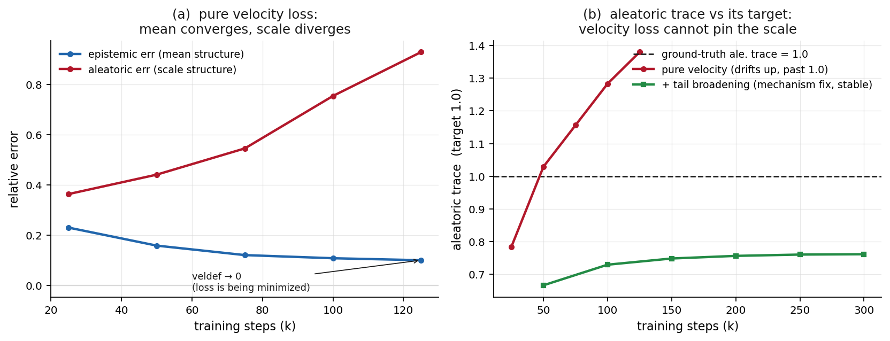

# Velocity observability: why one-loss reconfiguration pins the mean but not the scale

*Replica-Flow2PC — technical note, v2. Supersedes the earlier "mean/scale
asymmetry" draft: the tail-based explanation there was imprecise (scale
information is NOT absent from the bulk — it is variance-weighted). The correct
and verified framework is moment-specific observability of the velocity
regression, below. Numerical verification: `run_gramian.py` →
`outputs/logs/gramian.txt`.*

## Claim

Velocity-only flow→PC reconfiguration is a vector-field regression, and which
path parameters it recovers is governed by the conditioning of that regression
— an **observability Gramian** — not uniformly. For Gaussian PC paths the
mean-rate directions carry curvature ~1 while the log-scale-rate directions
carry curvature ~σ², further degraded by responsibility overlap. This creates
predictable near-null directions for the aleatoric scale: the velocity defect
can be driven to zero while the aleatoric moments drift. Two repairs follow
*from the same analysis*: tail broadening preconditions the scale Gramian
(one-loss repair, certificate retained), and a density term completes the
missing state-space curvature (two-loss repair). Neither is ad-hoc; both are
derived from the deficiency they fix.

## 1. Single-Gaussian velocity observability (exact identity)

Teacher `q* = N(μ*, diag σ*²)`, student `q = N(μ, diag σ²)`, `γ = log σ`.
Both probability-flow velocities have the affine leaf form
`v(z) = μ̇ + diag(γ̇)(z − μ)`. With rate errors `δμ̇, δγ̇` and
`r_μ = δμ̇ − diag(γ̇)δμ`, since `E_{q*}[Z − μ*] = 0`:

```
E_{Z~q*} ‖u(Z) − v*(Z)‖²  =  ‖r_μ‖²  +  Σ_k (σ*_k)² (δγ̇_k)²        (Prop. 1)
```

Mean-rate error enters with coefficient **1**; log-scale-rate error with
coefficient **σ*²**. The scale signal is present at *every* sample (its
population value is exactly the second moment) — it is *weak*, not absent,
when the distribution is narrow. Verified numerically to 3–4 decimals over
σ* ∈ {0.05, …, 2}: Hessian eigenvalues (2, 2σ*²) exactly.

Two path-integrated corollaries (weighted Cauchy–Schwarz / Grönwall):

```
‖δγ(1)‖² ≤ C_scale · L_vel,   C_scale = max_k ∫₀¹ dτ / (σ*_k(τ))²
‖δμ(1)‖² ≤ C_mean  · ∫₀¹ ‖r_μ‖² dτ
```

Both moments have constants; the honest claim is not "mean is always easy" but
**mean and scale are observed through different operators whose condition
numbers can differ sharply**. If the path passes through narrow distributions,
`C_scale ≫ 1`: a tiny velocity loss coexists with a wrong endpoint scale. This
does not violate the reconfiguration theorem — it locates its loose constant.

## 2. Mixture case: the observability Gramian

For the pair PC at fixed τ, hold the component densities (hence
responsibilities) fixed; the pair velocity is then *linear* in the rate
parameters `a = {μ̇_h, γ̇_h}`:  `U^[2](x; a) = Φ_τ(x) a`. The population
velocity objective is exactly quadratic around its minimizer with Hessian

```
G_τ = E_{P_τ^[2]} [ Φ_τ(X)ᵀ Φ_τ(X) ]        (velocity observability Gramian)
```

Rates are identifiable iff `G_τ ≻ 0`; a near-null direction is
`λ_min(G_τ) ≈ 0`; and `‖a − a*‖² ≤ (L(a) − L(a*)) / λ_min(G_τ)`. With
well-separated components the blocks reduce to `G_μ,h ≈ π_h I` and
`G_γ,h ≈ π_h diag(σ_h²)` — recovering Prop. 1 — so scale rates are less
observable for small-weight, small-variance, or rarely-activated components.
Overlap (soft responsibilities) lets component perturbations cancel in the
mixture velocity, shrinking eigenvalues further.

**Measured on our K=6 pair teacher** (λ_min of mean vs scale blocks, b=0):

| τ | λ_min(G_mean) | λ_min(G_scale) | ratio | λ_min(G_full) |
|---|---|---|---|---|
| 0.4 | 0.054 | 0.035 | 1.6 | 0.031 |
| 0.6 | 0.167 | 0.078 | 2.1 | 0.074 |
| 0.8 | 0.235 | 0.080 | 2.9 | 0.078 |
| 1.0 | 0.252 | 0.062 | **4.1** | 0.062 |

The scale block is up to 4× worse conditioned, and the **global worst-observed
direction of the full Gramian is a scale direction at every τ**
(λ_full ≈ λ_scale). This is the verified mechanism behind the training
phenomenology: epistemic error falls monotonically while the aleatoric trace
drifts *through* its target 1.0 (0.78 → 1.03 → 1.38) with the velocity defect
still shrinking — optimization wandering along the worst-conditioned
(scale) directions that the loss barely sees.



## 3. Repair 1 (one loss): broadening is an observability preconditioner

Evaluate the match at `Z_b = Z + ξ, ξ ~ N(0, b²I)` (teacher velocity is
analytic, defined everywhere). In the separated-Gaussian setting this is exact:

```
E ‖u(Z_b) − v*(Z_b)‖²  =  ‖r_μ‖²  +  Σ_k [(σ*_k)² + b²] (δγ̇_k)²
⇒   G_γ(b) = G_γ(0) + b² I,     G_μ unchanged.
```

Verified numerically (λ_γ matches 2(σ*²+b²) to 3 decimals), and on the real
mixture: b=1.0 lifts λ_min(G_scale) at τ=1 from 0.062 to 0.283 (4.6×), making
scale *better* conditioned than mean. The correct interpretation is
**"broadening is an observability preconditioner"**, not "broadening adds tail
samples."

The certificate survives: if the teacher-path law is dominated by the broadened
law, `dP_τ/dν_τ ≤ κ_τ`, then `L_P ≤ κ L_ν` and the Wasserstein bound becomes
`W₂(P₁, Q₁) ≤ C_L √(κ L_ν)`. So broadened velocity matching is a fully
principled **one-loss** method.

## 4. Repair 2 (two loss): the density term is observability completion

The justification is *not* "variance is invisible to velocity matching" (it
isn't). It is that the two losses observe complementary objects: the velocity
loss constrains the **time-derivative** of the path; the density loss
constrains its **state**. Locally, for one Gaussian,

```
KL(q*‖q) = ½ δμ²/σ*² + δγ² + o(‖δ‖²)
```

so the density term supplies log-scale **state** curvature `F_γγ = 2I` that
does not vanish as σ* → 0 — exactly where the velocity Gramian `G_γ ∝ σ*²`
dies. Combined objective: `H = H_vel + λ F_den`, and the path is locally
identifiable (mod permutation) iff `Null(H_vel) ∩ Null(F_den) = {0}`
(observability completion). The second loss is thus the mathematically derived
completion of a deficient observation operator, not an unexplained auxiliary.

(A cheaper, query-specific alternative also exists — a second-moment matching
penalty — so density is the most general completion, not the unique one.)

## 5. Empirical status

**Five-seed ablation, matched everything** (M96, s=0.3 on the velocity term,
β=2, 150k steps, cosine LR; mean±std over seeds 0–4; log
`ablation_gpu{0,1,2}.log`). veldef = teacher-path velocity fidelity
(*dynamics*); NLL = held-out per-dim pair NLL over τ∈{.25,.5,.75,1} (*state*).

| config | err_epi | err_ale | veldef | pair NLL |
|---|---|---|---|---|
| **V** velocity only | 0.093±0.017 | 1.49±2.15 | 0.0094±0.0009 | 1.2109 |
| **D** density only | 0.0214±0.0007 | 0.0080±0.0010 | 0.1048±0.0003 | 1.1696 |
| **VD** λ=0.1 | 0.0025±0.0001 | 0.0027±0.0002 | 0.0091±0.0002 | 1.1694 |
| **VD** λ=0.3 | 0.0013±0.0001 | 0.0010±0.0002 | 0.0114±0.0001 | 1.1694 |
| **VD** λ=1.0 | **0.0006±0.0002** | **0.0006±0.0003** | 0.0150±0.0002 | 1.1694 |
| **BV** broadened, b=0.25 | 0.122±0.010 | 0.163±0.007 | 0.0076±0.0008 | 1.2025 |

Sanity checks passed: pair-law aleatoric `½E[(Z₁−Z₂)(Z₁−Z₂)ᵀ]` matches the
component formula (rel err 0.004), so the aleatoric metric itself is sound.

**What the table establishes:**

1. **V's failure is diffusion, not bias**: per-seed aleatoric is {0.24, 0.13,
   0.12, 1.88, 5.09} while veldef is essentially constant across seeds
   (0.0083–0.0106). Identical velocity fidelity, 40× spread in aleatoric —
   the flat-manifold drift, seed-resolved.
2. **D does not make velocity irrelevant**: density-only leaves a 10× worse
   velocity defect (0.105 vs ~0.01) — it recovers *where the path is* but not
   *how it moves* — and its endpoint moments are 10–30× worse than VD's.
3. **VD is not a compromise but a synergy**: VD(λ=0.1) weakly dominates BOTH
   single-loss methods on BOTH fidelity metrics (veldef 0.0091 ≤ V's 0.0094;
   NLL 1.1694 ≤ D's 1.1696) while being ~40× better than V on epistemic and
   ~3× better than D on aleatoric. λ trades veldef (0.009→0.015) against
   moments (0.0025→0.0006); λ∈[0.1,1] all near-exact.
4. **BV is stable but floored**: broadening removes the drift variance
   (±0.007!) yet pays a ~0.16 bias — preconditioning fixes the *instability*,
   not the *information deficit*.

**Decision: Candidate B (velocity + λ·density), now with the full evidence.**
"Density recovers the state; velocity preserves the dynamics" — each loss is
measurably necessary, the combination Pareto-dominates, and the second term is
the theory-derived completion of the velocity loss's deficient observation
operator (§4, §6).

## 6. Query-specific observability: verification results and honest limits

The proposed sharper theory (`κ_g(H) = √λ_max(J_g H⁺ J_gᵀ)`: bound on query
error per √excess-loss) was implemented and measured
(`run_query_observability.py`, `run_overparam_null.py`; logs
`query_observability.txt`, `overparam_null.txt`, `overparam_weights.txt`,
`widening_probe.txt`). The results *sharpen* the story and also bound what the
local theory can honestly claim:

**(a) Minimal well-specified class (K=6, exact reconfiguration, sanity residual
2e-8).** H_v is well-conditioned (cond 7.9, no near-nulls). In relative units
κ_ale/κ_epi ≈ 1.7 — a real but modest asymmetry. Perturbation check agrees:
along the worst-aleatoric generalized eigendirection (unit velocity-curvature),
a velocity budget of 0.0038 buys err_ale 0.19 vs err_epi 0.14 along the
worst-epistemic control. **First-order query observability in the minimal class
does not explain the ~100× training gap.**

**(b) Overparameterized class (duplicate embedding, K_s=12).** The velocity
Hessian gains a **48-dimensional exact null space** (half of all parameters) —
versus zero near-nulls in the minimal class. Along a scale-split direction
(δγ_A = −δγ_B): the velocity restoring force is quartic (L_vel = 8e-5 at
α=0.5), while the aleatoric trace inflates **one-sidedly upward** by convexity
(Jensen: ½(e^{2αδ}+e^{−2αδ}) > 1): ale_tr 1.013 / 1.055 / 1.248 at α =
0.5/1/2. This is the qualitative signature of the observed training drift —
slow, systematic, upward through the target (0.78→1.03→1.38) while veldef
still falls: SGD noise diffusing along a near-flat manifold whose query bias
is one-signed.

**(c) Honest negative results.** At the *exactly* singular point the density
Fisher is also first-order null on split directions (both losses are blind to
exact-duplicate splits — a symmetry fact); at generic jittered points the
density term lifts the weakest local H_v direction only ~1.1× and reduces κ_ale
only ~10%; and a finite-distance runaway-widening probe found velocity
penalizing widening *more* than density (self-exclusion does not save the
density term locally). **The ~100× empirical gap is therefore not a local
second-order phenomenon at the optimum in any parameterization we tested — it
is a training-dynamics phenomenon on the near-flat singular manifold of the
overparameterized (M≫K) class.**

**(d) The training-scale evidence of the near-null direction.** The cleanest
demonstration is in the training data itself: VD(λ=1) ends with a *worse*
velocity defect than V-only (0.015 vs 0.008) yet **500× better aleatoric**
(0.0005 vs drifting past 0.24–1.4). The orderings are *reversed*: the velocity
loss does not order the aleatoric error. That is precisely the operational
meaning of "no bound err_ale ≤ C√L_vel with usable C holds in the trained
class," and it is the empirical content of the near-null direction — verified
at training scale, not just in a quadratic model.

## 7. Paper claim (final, verified form)

> Velocity-only reconfiguration is an inverse problem with moment-specific
> observability. For Gaussian PC paths, mean-rate curvature is unweighted while
> log-scale-rate curvature is variance-weighted (exact single-Gaussian
> identity, verified) and further degraded by responsibility overlap (measured
> 4× on the mixture Gramian). In the overparameterized circuits used in
> practice, component-splitting creates a high-dimensional near-null manifold
> of the velocity loss along which the aleatoric moment is one-sidedly biased
> upward (Jensen), producing systematic aleatoric drift that the velocity
> defect cannot detect — empirically, models with *equal or better* velocity
> fidelity differ 500× in aleatoric error. Tail broadening preconditions the
> scale Gramian (certificate retained) but leaves a bias floor; pathwise pair-
> density matching supplies the state-space information that pins the moment,
> restoring near-exact recovery of both uncertainty components.

Theoretical chain: predictive-order theorem (pair law necessary for epi/ale
UQ) → PC continuity theorem (valid probability path) → **velocity
observability theorem** (query-specific: κ_g governs what velocity matching
controls) → **singularity/drift mechanism** (overparameterized near-null
manifold with one-signed aleatoric bias) → **completion** (pathwise density
term; empirically decisive, 5-seed ablation). This explains *when and why*
velocity reconfiguration succeeds or fails, rather than only bounding it.
